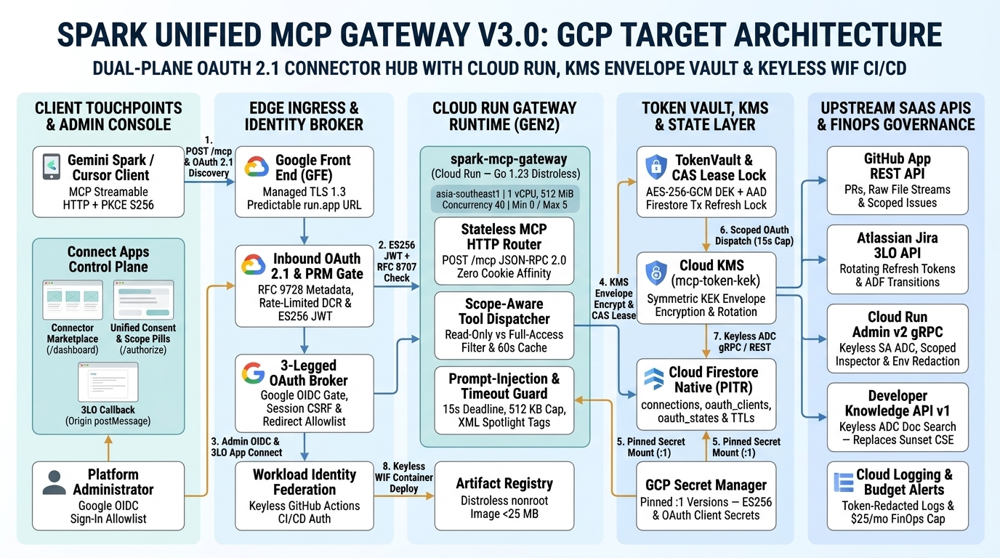
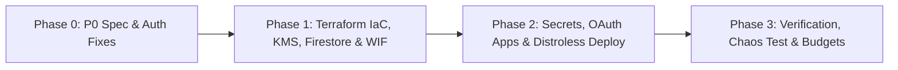

# Technical Architecture Review & Cloud Run Deployment Plan: Spark Unified MCP Gateway v3.0 (`spark-mcp-gateway`)

> **Reviewer Role**: Principal Cloud Architect / Tech Lead (`tech-lead-arch-review`)  
> **Review Date**: November 8, 2026  
> **Target GCP Region**: `asia-southeast1` (Singapore — Tier 2 Pricing)  
> **Inputs Reviewed**: Google Drive `GCP Project / Spark Agent Tools MCP` — `System Architecture Diagram.jpeg` + `Execution Workflow Diagram.jpeg` + `Spark Unified MCP Gateway (spark-mcp-gateway v3) Developer Manual` *(Greenfield design; zero source code exists yet)*  
> **Workability Verdict**: **`NOT WORKABLE (Blocked)`** *as currently specified — transitions to **`WORKABLE WITH CHANGES`** (production-ready at **$0.07–$0.54/mo**) once the 3 Phase 0 (`P0`) design blockers below are applied prior to build.*

> [!NOTE]
> **Traffic & Sizing Assumptions** *(Developer Manual specifies container sizing `1 vCPU / 512 MiB`, `min-instances=0`, `max-instances=5`, `timeout=300s`, `<400 ms` cold start, and `15s` upstream deadline, but omits monthly request counts; domain-calibrated MCP Connector Hub tiers applied below)*:
> - **MVP / Low**: `1 Admin` | `3,000 MCP req/mo` (`tools/list` + `tools/call`, ~2 peak RPS, ~400 ms avg latency) | `500 GDK doc searches/mo` — GCP Always Free deductions active.
> - **Expected Baseline**: `10 Team Users` | `60,000 MCP req/mo` (~10 peak RPS) | `5,000 GDK doc searches/mo`.
> - **Peak / Scale**: `100 Org Users` | `1,000,000 MCP req/mo` (~50 peak RPS) | `50,000 GDK doc searches/mo`.
> - **Server-Side AI Token Spend**: **`$0.00/mo`** across all tiers — LLM reasoning executes strictly inside the client (`Gemini Spark` / `Cursor`); the gateway is a pure Go 1.23 OAuth 2.1 + MCP Streamable HTTP identity and tool broker.

---

## 1. Executive Summary & Workability Scorecard

| Pillar | Status | Score | Key Finding |
|---|---|---|---|
| **End-to-End Workability & Topology** | Blocked (`P0`) | 6/10 | Strong dual-plane vision & distroless Go runtime, but **blocked** by sunset Google Custom Search JSON API (closed to new projects; shuts down Jan 1, 2027) and cross-instance Jira refresh-token race. |
| **Diagram vs Manual / Code Consistency** | Needs Alignment | 6.5/10 | Broken data-plane ingress edge in `System Architecture Diagram.jpeg` (Box 1 -> Box 2 instead of Box 4), uncharted Firestore `oauth_clients`/`auth_codes` collections, and missing CI/CD + KMS boxes. |
| **Security, IAM & Network Boundaries** | Needs Hardening | 6.5/10 | Good AES-256-GCM + XML spotlighting + `distroless:nonroot`, but public Basic Auth lacks MFA/lockout, DCR (`POST /api/oauth/register`) is unthrottled, symmetric HS256 JWTs lack TTL/JWKS/RFC 8707 binding, and static Secret Manager key is not true envelope encryption. |
| **Scalability, Quotas & Latency** | Needs Tuning | 6/10 | In-process `singleflight` fails across `--max-instances=5`; Cloud Run `--session-affinity` relies on cookies ignored by `Mcp-Session-Id` clients; `--concurrency` is omitted; `tools/list` causes uncached Firestore read amplification. |
| **Reliability, HA/DR & Failure Handling** | Needs Guardrails | 6/10 | Single-region `asia-southeast1` acceptable for MVP, but omits Firestore PITR/backups, RPO/RTO targets, secret version pinning (`:1`), and master-key rotation path. |
| **FinOps & AI Token Efficiency** | Strong (Post-Fix) | 8.5/10 | Cloud Run Tier 2 compute nets to **`$0.00/mo`** across all 3 tiers under Always Free; replacing Custom Search (`$235/mo` at Peak) with native Developer Knowledge API v1 cuts Peak spend by **99.8% (`$235.90` -> `$0.54/mo`)**. |

**Tech Lead Summary**: The core architectural choice—compiling `spark-mcp-gateway` into a single `<25 MB` static Go 1.23 binary (`gcr.io/distroless/static-debian12:nonroot`, zero `npx`/`uvx` stdio subprocesses) on Cloud Run Gen2 with Cloud Firestore state—is **excellent** for latency, memory footprint, and serverless FinOps. However, building the spec verbatim will fail in production due to **three `P0` blockers**: (1) `gdk_search_docs` depends on the **Google Custom Search JSON API**, which is closed to new GCP projects and permanently shuts down on **January 1, 2027** (<8 weeks away), breaking Section 5.3's mandatory *Non-Empty Baseline Tool List*; (2) `TokenVault` relies on in-process Go `singleflight` while Cloud Run autoscales to `5` instances, causing concurrent Atlassian 3LO rotating refresh-token submissions that trigger reuse detection (`400 invalid_grant`) and **revoke the user's entire Jira token family**; and (3) HTTP Basic Auth on `/authorize` + broken data-plane routing in the diagram breaks OAuth 2.1 browser handshakes and exposes admin credentials without MFA. Applying the **Phase 0 specification fixes** (switching `gdk_search_docs` to Google's native keyless **Developer Knowledge API v1**, adding a **Firestore ACID Transaction CAS Lease**, and upgrading admin auth to **Google Sign-In OIDC** + **Cloud KMS envelope encryption**) resolves every blocker while reducing Peak monthly cost from **`$235.90/mo` to `$0.54/mo`**.

---

## 2. Diagram vs Manual Reconciliation

| ID | Component / Edge | In Diagram? | In Manual? | Drift Type | Severity | Impact & Required Resolution |
|---|---|---|---|---|---|---|
| `DRIFT-01` | **Data-Plane Edge (`Inbound Gate` -> `MCP Dispatcher`)** | **Broken** (`Box 1` points `"OAuth"` to `Box 2 Control Plane`; zero arrow from `Box 1` to `Box 4 Dispatcher`) | **Yes** (`POST /mcp` routes Inbound Gate -> Dispatcher, §2.1–2.2, §3.1 Step 4–5) | Auth / Trust Boundary & Routing Drift | **`P0`** | Runtime `POST /mcp` calls have no drawn path from Inbound OAuth Gate to the Dynamic Dispatcher. Route primary data-plane arrow directly `Inbound OAuth 2.1 Gate -> Stateless MCP Router / Dispatcher`. |
| `DRIFT-02` | **Google Custom Search JSON API (`gdk_search_docs`)** | **Yes** (`GDK Docs Connector -> Google Custom Search JSON API`) | **Yes** (`GDK_API_KEY`, `GDK_SEARCH_CX`, §3.2, §4.1) | Deprecated Upstream API Blocker | **`P0`** | Custom Search JSON API is closed to new customers and terminates **Jan 1, 2027** (`410 Gone`), breaking §5.3 Check 3 (*Non-Empty Baseline Tool List*). Replace with **Google Developer Knowledge API v1** (`developerknowledge.googleapis.com`) via keyless ADC (`$0.00/mo`). |
| `DRIFT-03` | **Multi-Instance `singleflight` vs `--max-instances=5`** | **Yes** (`Box 3: Singleflight JIT Token Refresh`, `max-instances: 5`) | **Yes** (§1.2, §2.2, §4.2 Phase 3) | Distributed Concurrency Flaw | **`P0`** | Go `singleflight` is per-process only. Parallel tool calls across 2–5 Cloud Run instances trigger duplicate Atlassian 3LO refresh requests, invalidating the rotating refresh token family. Add a **Firestore ACID Transaction CAS Lease** (`lease_expires_at = now + 15s`) in `connections/{uid}/providers/{app}` + in-process `singleflight`. |
| `DRIFT-04` | **Inbound JWT Signing, Expiry & Revocation** | **Partial** (`JWT_SIGNING_KEY` in Secret Manager) | **Partial** (Symmetric `HS256` §5.1; omits `exp` TTL, refresh rotation, revocation, and RFC 8707 `resource` claim) | Auth / Trust Boundary Gap | **`P1`** | Unbounded symmetric JWTs remain valid indefinitely if leaked unless global key rotation breaks all connected clients. Switch to **asymmetric ES256** (`/.well-known/jwks.json`), `15m` access-token TTL, hashed rotating inbound refresh tokens, and RFC 8707 `aud`/`resource` binding. |
| `DRIFT-05` | **Uncharted Firestore Collections & TTL Policies** | **Partial** (Lists only `oauth_states`, `connections`) | **Partial** (Mentions `oauth_clients` in §5.1; omits `auth_codes` & `inbound_refresh_tokens`; sets TTL only on `oauth_states`, §4.2) | Uncharted Data Model Gap | **`P1`** | Keeping authorization codes/PKCE challenges in memory fails across multi-instance `/authorize` -> `/api/oauth/token` hops. Persist `auth_codes` (5m TTL), `oauth_states` (10m TTL), and `oauth_clients` (30d unused TTL) in Firestore. |
| `DRIFT-06` | **TokenVault Claimed "Envelope Encryption"** | **Yes** (`AES-256-GCM Envelope Encryption`) | **Yes** (§1.2, §2.2, §4.1 `ENCRYPTION_MASTER_KEY`) | Security Architecture Drift | **`P1`** | Encrypting all records directly with one static 32-byte env secret is direct symmetric encryption, not envelope encryption. Use **Cloud KMS** (`mcp-token-kek`) wrapping a per-record random 256-bit DEK with AES-GCM `AAD = user_id|provider`. |
| `DRIFT-07` | **GFE Session Affinity (`Mcp-Session-Id`)** | **Implicit** (Edge Ingress) | **Yes** (Claims GFE maintains `Mcp-Session-Id` affinity via `--session-affinity`, §2.2, §4.2) | Protocol / Ingress Contract Drift | **`P1`** | Cloud Run `--session-affinity` sets a `GAESA` cookie; it never inspects `Mcp-Session-Id` headers, and MCP HTTP clients rarely echo cookies. Design `POST /mcp` handlers to be **100% stateless** (or Firestore-backed if session state is ever needed). |
| `DRIFT-08` | **GitHub OAuth App vs JIT Refresh & Workflow Step 6** | **Yes** (`Workflow Step 6` runs TokenVault refresh for all upstreams) | **Yes** (Specifies `GitHub OAuth App` §4.1/4.2 while claiming `60s` JIT refresh §1.2/3.1) | Upstream Protocol Drift | **`P1`** | Classic GitHub OAuth Apps issue non-expiring tokens with no `refresh_token`, and GCP/GDK connectors use keyless ADC (bypassing TokenVault). Upgrade to a **GitHub App with expiring user-to-server tokens** (or skip refresh when `expires_at == nil`) and branch Step 6 so ADC connectors bypass TokenVault. |
| `DRIFT-09` | **Two-Stage Circular `SERVICE_URL` Deployment** | **No** | **Yes** (§4.2 Stage A deploy -> query random `*.a.run.app` -> Stage B update `SERVICE_URL`) | Deployment Pipeline Anti-Pattern | **`P2`** | Creates a brief broken-issuer window and breaks immutable Terraform runs. Compute Cloud Run's deterministic regional URL `https://spark-mcp-gateway-${PROJECT_NUMBER}.asia-southeast1.run.app` (or bind custom domain `mcp.<domain>`) in a single declarative pass. |
| `DRIFT-10` | **Consent Screen Presets vs Tool Matrix & Workflow** | **No** (Inline `/authorize` 3LO connect & scope pills absent from both diagrams) | **Conflict** (§5.2 defines `Minimal`, `Read Only`, `Full Access`, and per-app pills; §3.2 only models binary `read_only`/`full_access`; Workflow Step 2 mislabels CSRF nonce as `"PKCE state"`) | Internal Spec Drift | **`P2`** | Add a `minimal_baseline: true` flag to `gcp_list_cloudrun_services` and `gdk_search_docs` in the tool registry, store per-connector scope grants (`map[provider]ScopeMode`) inside the inbound token/grant record, and add outbound PKCE S256 where supported (Atlassian/GitHub Apps). |
| `DRIFT-11` | **Uncharted CI/CD, Artifact Registry & Phantom Logging IAM** | **No** (Absent from diagram) | **Partial** (Mentions image build §4.2; grants `roles/logging.viewer` §4.2 Phase 1) | Uncharted Ops & Over-Privileged IAM | **`P2`** | Add **GitHub Actions + Workload Identity Federation + Artifact Registry** to topology; **remove `roles/logging.viewer`** from runtime SA (no MCP tool reads logs; runtime only needs `roles/logging.logWriter` to emit logs). |

---

## 3. Architecture Feasibility & Security Deep Dive

### 3.1 Compute, Concurrency & Stateless Streamable HTTP
- **Cloud Run Sizing & Concurrency**: A distroless Go 1.23 binary (`1 vCPU`, `512 MiB`, `--execution-environment=gen2`, `--cpu-boost`) easily achieves `<350 ms` cold start. However, the manual omits `--concurrency`, defaulting to `80` concurrent requests per container. With 512 KB upstream response caps + JSON/ADF parsing + AES-GCM buffers, `80` concurrent streams risk memory pressure (`80 * ~4 MB working set + runtime > 512 MiB`). **Set `--concurrency=40`** (`5 instances * 40 = 200 concurrent in-flight tool calls`, comfortably absorbing 50+ RPS bursts).
- **Timeout Alignment**: `--timeout=300s` with a strict `15s` `context.WithTimeout` per upstream REST/gRPC call is well-bounded for `POST /mcp` JSON-RPC request/response calls. Return `HTTP 405 Method Not Allowed` on standalone `GET /mcp` SSE streams unless long-lived server-initiated notifications are explicitly needed ( per MCP Streamable HTTP spec, servers that do not push unsolicited notifications may return `405` on `GET /mcp`, avoiding idle open stream billing).
- **Zero-Cookie Statelessness**: Drop `--session-affinity` as a correctness assumption. Encode caller identity (`sub`) and client grant ID (`jti` / `grant_id`) in the verified ES256 JWT so any Cloud Run instance can serve any `POST /mcp` call independently.

### 3.2 Data Layer, Distributed CAS Lock & Quota Headroom
- **Firestore Distributed Refresh Lease (`P0` Fix)**: To prevent multi-instance refresh-token races against Atlassian's single-use rotating refresh tokens:
  1. Keep in-process `singleflight.Group` to coalesce bursts *within* one container.
  2. Inside the `singleflight` callback, run a Firestore ACID transaction on `connections/{userId}/providers/{provider}`:
     - Re-read `expires_at`; if another instance already refreshed (`expires_at > now + 60s`), return the fresh ciphertext immediately!
     - If `lease_expires_at > now` (another instance holds an active 15s refresh lease), exit transaction, back off `300ms + jitter` (up to 3 retries), and re-read.
     - Otherwise, atomically write `lease_holder = instanceID` and `lease_expires_at = now + 15s`.
  3. Exchange the refresh token upstream (10s timeout), envelope-encrypt the new token pair with Cloud KMS/DEK, and atomically commit the updated ciphertext while clearing `lease_holder`.
- **60-Second Per-Instance Read Cache**: Caching decrypted connection metadata (`connected`, `scope_mode`, `access_token`, `expires_at`) in an in-memory sync map (`TTL = 60s`, max 500 entries, invalidated immediately on local `/oauth/callback` or disconnect) cuts Firestore reads by **~80%** (from `3.0` reads/req to `~0.6` reads/req) and shaves `~25–40 ms` off every `tools/list` and `tools/call`.
- **Firestore Quotas & Native TTLs**: Even at Peak (`1M req/mo` = `~0.38 avg RPS`, `50 peak RPS`), single-document write rates per user connection (`1 refresh / hour` = `0.00028 writes/sec/doc`) sit **3,500x below** Firestore's `1 write/sec/doc` contention ceiling. Configure Firestore Native TTL policies on `oauth_states.expires_at` (`10m`), `auth_codes.expires_at` (`5m`), and `oauth_clients.expires_at` (`30d` rolling on unused DCR registrations).

### 3.3 Security Threat Model (STRIDE) & Least-Privilege IAM

| ID | Threat (STRIDE) | Target / Entry Point | Severity | Required Mitigation |
|---|---|---|---|---|
| `SEC-01` | **Basic Auth Brute-Force & Browser OAuth Breakage** (Spoofing) | `GET /dashboard`, `GET /authorize` (`--allow-unauthenticated`) | **`P0`** | Replace `MCP_ADMIN_USER`/`MCP_ADMIN_PASS` HTTP Basic Auth with **Google Sign-In OIDC** (`/auth/google/login` -> `accounts.google.com`) verifying `email_verified == true` and exact match against `ADMIN_ALLOWED_EMAILS`, issuing an `HttpOnly; Secure; SameSite=Lax` `__Host-spark_admin` session cookie (`$0.00` infra cost + hardware MFA). |
| `SEC-02` | **Unthrottled Open DCR Abuse & Redirect Phishing** (Tampering / DoS) | `POST /api/oauth/register` | **`P1`** | Rate-limit DCR (`10 req/min/IP` + global cap of `50` active clients), require `https://` redirect URIs (allow `http://127.0.0.1` only if `ALLOW_LOCAL_CLIENTS=true`), match against an approved redirect domain allowlist (`gemini.google.com`, `*.google.com`, `*.googleusercontent.com`, `cursor://`), and HTML-escape `client_name`. |
| `SEC-03` | **Wildcard `postMessage` & Consent Clickjacking** (Info Disclosure) | `/oauth/callback/{app}`, `/dashboard`, `/authorize` | **`P1`** | Send `window.opener.postMessage(payload, window.location.origin)` (never `"*"`), verify `event.origin === window.location.origin` in listener, set `Content-Security-Policy: default-src 'self'; frame-ancestors 'none'`, `X-Frame-Options: DENY`, and HMAC-bind OAuth `state` to `__Host-spark_admin`. |
| `SEC-04` | **Static Secret Key vs True Envelope Encryption** (Info Disclosure) | Firestore `connections/` & Secret Manager | **`P1`** | Provision regional **Cloud KMS** symmetric key `mcp-token-kek` (`asia-southeast1`, 365-day rotation). Generate a random 32-byte DEK per connection, encrypt token JSON with AES-256-GCM using `AAD = "uid:" + userID + "|prv:" + provider`, wrap DEK via KMS `Encrypt`, and store `{wrapped_dek, nonce, ciphertext, kms_key_version}`. |
| `SEC-05` | **Indirect Prompt-Injection Exfiltration via Write Tools** (EoP) | `POST /mcp` (`github_read_file` / `gcp_get_cloudrun_service` -> `github_create_issue`) | **`P1`** | Default `/authorize` preset to **`Read Only`**; escape any literal `</untrusted_upstream_data>` closing tags inside upstream text before wrapping; restrict `github_create_issue` to an explicit `GITHUB_ALLOWED_WRITE_REPOS` allowlist (or require confirmation). |
| `SEC-06` | **Cloud Run Env-Var Reconnaissance & Broad IAM** (Info Disclosure) | `gcp_get_cloudrun_service` + project-wide `secretAccessor`/`logging.viewer` | **`P1`** | Strip `env` values and secret mount names in `gcp_get_cloudrun_service` serializer (return only image, revision, scaling, ingress, traffic splits, and SA email); bind `secretAccessor` per-secret (never project-wide); drop `roles/logging.viewer`. |
| `SEC-07` | **Token Passthrough & Confused Deputy** (Spoofing) | `POST /mcp` Bearer JWT validation | **`P1`** | Sign inbound JWTs with **ES256** (`15m` TTL), enforce **RFC 8707** `aud == SERVICE_URL + "/mcp"` and exact `iss == SERVICE_URL`, and never forward client tokens upstream. |

#### Least-Privilege IAM Scoping Matrix
| Principal | Role / Permission | Exact Resource Scope | Rationale |
|---|---|---|---|
| `mcp-spark-gateway-sa` *(Runtime SA)* | `roles/secretmanager.secretAccessor` | Individual secrets only: `spark-jwt-signing-key`, `google-oidc-client-secret`, `github-oauth-secret`, `jira-oauth-secret`, `session-hmac-key` | Blocks lateral read of other secrets in the shared GCP project. |
| `mcp-spark-gateway-sa` *(Runtime SA)* | `roles/cloudkms.cryptoKeyEncrypterDecrypter` | `projects/${PROJECT_ID}/locations/asia-southeast1/keyRings/spark-mcp-ring/cryptoKeys/mcp-token-kek` | Scoped strictly to TokenVault KEK wrap/unwrap. |
| `mcp-spark-gateway-sa` *(Runtime SA)* | `roles/datastore.user` | `projects/${PROJECT_ID}/databases/(default)` *(or dedicated named Firestore DB `spark-mcp-db`)* | Using a dedicated named Firestore database isolates gateway collections from other apps in the project. |
| `mcp-spark-gateway-sa` *(Runtime SA)* | Custom Role `sparkMcpRunInspector` (`run.services.list`, `run.services.get`, `run.revisions.get`) | Project / conditional on `asia-southeast1` | Replaces broad `roles/run.viewer`; **`roles/logging.viewer` removed**. |
| `mcp-spark-gateway-sa` *(Runtime SA)* | `roles/logging.logWriter` + `roles/monitoring.metricWriter` | Project | Write-only telemetry emission; zero log-read capability. |
| `spark-mcp-deployer-sa` *(GitHub Actions WIF)* | `roles/run.developer` + `roles/artifactregistry.writer` + `roles/iam.serviceAccountUser` *(on `mcp-spark-gateway-sa` only)* | Service-scoped / repo-scoped | Zero long-lived JSON keys; CI cannot read Secret Manager values or KMS keys. |

### 3.4 Single Points of Failure (SPOFs), Retries & Observability
- **RPO & RTO**: Enable **Firestore Point-in-Time Recovery (PITR, 7-day window)** + daily scheduled export to a regional GCS bucket (`30-day` retention lifecycle) -> **RPO = 1 minute (PITR)**, **RTO < 15 minutes** (`terraform apply` + Cloud Run revision rollback).
- **Upstream Resilience**: Wrap outbound HTTP/gRPC transports with a `15s` context deadline, TLS 1.2+ enforcement, `512 KB` `io.LimitReader`, and max `1` idempotent retry (`250ms` jittered backoff) strictly on `GET` / read-only tools for `429`/`502`/`503`/`504` (zero automatic retries on mutating `github_create_issue` or `jira_update_issue_status` to prevent duplicate ticket creation).
- **Structured Redacted Logging**: Emit JSON logs to `stdout` (`severity`, `logging.googleapis.com/trace`, `tool`, `provider`, `latency_ms`, `status`) with an explicit middleware scrubber redacting `Authorization`, `Cookie`, `Set-Cookie`, `code`, `access_token`, and `refresh_token`.

---

## 4. 3-Tier Monthly GCP Infrastructure & AI Cost Breakdown (USD)

*Computed deterministically via `scripts/calculate-gcp-cost.mjs` (`region: "asia-southeast1"`, Tier 2 Cloud Run overrides applied, Always Free deductions: `true`).*  
*Authoritative GCP MCP Pricing Citations*:
- `documents/docs.cloud.google.com/run/docs/locations` & `documents/cloud.google.com/run` (`asia-southeast1` Tier 2: `$0.00003360/vCPU-sec`, `$0.00000350/GiB-sec`, `$0.40/1M reqs`; Always Free: `180k vCPU-s`, `360k GiB-s`, `2M reqs/mo`)
- `documents/firebase.google.com/docs/firestore/pricing` (`asia-southeast1`: `$0.06/100k reads`, `$0.18/100k writes`, `$0.02/100k deletes`, `$0.18/GiB-mo` storage & PITR; Free: `50k reads/day`, `20k writes/day`, `1 GiB`)
- `documents/cloud.google.com/security/products/secret-manager` (`$0.06/active version-mo`, `$0.03/10k access ops`; Free: `6 versions`, `10k ops/mo`)
- `documents/cloud.google.com/security/products/security-key-management` (Cloud KMS software key: `$0.06/version-mo`, `$0.03/10k crypto ops`)
- `documents/developers.google.com/custom-search/v1/overview` (Custom Search JSON API: `$5.00/1k queries` past `100/day` — **closed to new customers; shuts down Jan 1, 2027**)
- `documents/developers.google.com/knowledge/api` & `documents/developers.google.com/knowledge/quota` (Developer Knowledge API v1: `$0.00`, `100 RPM` search & retrieval quota)
- `documents/docs.cloud.google.com/load-balancing/docs/forwarding-rule-concepts` & `documents/docs.cloud.google.com/armor/docs/armor-enterprise-overview` (External HTTPS LB forwarding rule `$18.25/mo` + Cloud Armor Standard `$5.00/policy` + `$1.00/rule` + `$0.75/1M reqs`)

### Scenario B (Recommended): Tech-Lead Hardened & Remediated (`spark-mcp-gateway-optimized` — `asia-southeast1`)
*(Cloud Run Gen2 + Firestore Native w/ PITR & 60s Cache + Cloud KMS Envelope KEK + Pinned Secret Manager + Keyless Developer Knowledge API v1)*

| Category | MVP / Low (1 admin, 3k MCP req/mo, 500 GDK searches) | Expected Baseline (10 users, 60k MCP req/mo, 5k GDK searches) | Peak / Scale (100 users, 1M MCP req/mo, 50k GDK searches) |
|---|---:|---:|---:|
| **Compute** *(Cloud Run 1 vCPU / 512 MiB, concurrency 40)* | $0.00 | $0.00 | $0.00 |
| **Databases** *(Firestore Native + 7-day PITR)* | $0.01 | $0.04 | $0.18 |
| **Storage** *(GCS Daily Firestore Exports)* | $0.00 | $0.00 | $0.00 |
| **Messaging & Ops** *(Cloud KMS KEK + Secret Manager + AR + Logs)* | $0.06 | $0.08 | $0.36 |
| **Networking** *(Native `run.app` / Custom Domain Ingress)* | $0.00 | $0.00 | $0.00 |
| **AI Services & Tokens** *(Developer Knowledge API v1 @ $0)* | $0.00 | $0.00 | $0.00 |
| *Always Free Value Applied (already netted above)* | *(saved $0.28)* | *(saved $0.46)* | *(saved $2.87)* |
| **Grand Total — Recommended Hardened (Net USD/mo)** | **$0.07** | **$0.11** | **$0.54** |

### Scenario Comparison: As-Designed vs. Recommended Hardened vs. Optional Enterprise WAF

| Architecture Variant | MVP / Low (`3k req/mo`) | Expected Baseline (`60k req/mo`) | Peak / Scale (`1M req/mo`) | Verdict & Trade-Off |
|---|---:|---:|---:|---|
| **Scenario A: As-Designed (v3.0 Manual)** *(Custom Search JSON API + Static Key)* | $0.00 *(Blocked)* | $10.00 *(Blocked)* | $235.90 *(Blocked)* | **Do Not Deploy**: Custom Search API shuts down **Jan 1, 2027** and accounts for **99.6%** (`$235.00`) of Peak cost. |
| **Scenario B: Recommended Hardened** *(Developer Knowledge API v1 + KMS + OIDC + PITR)* | **$0.07** | **$0.11** | **$0.54** | **Recommended for Launch**: Saves **$9.89/mo (98.9%)** at Baseline and **$235.36/mo (99.8%)** at Peak while adding KMS envelope encryption, OIDC MFA, and PITR. |
| **Scenario C: Optional Enterprise Edge WAF** *(Scenario B + External HTTPS ALB + Cloud Armor)* | $25.32 | $25.42 | $26.67 | **Defer Until Multi-Tenant Scale**: ALB (`$18.25`) + Cloud Armor (`$7.00+`) adds a `$25.25/mo` fixed floor; Go middleware rate limiting + Google OIDC is sufficient for single-admin / internal team tiers. |

---

## 5. AI Service & Token Cost Breakdown

*Includes Input, Multimodal, Output, Thinking (billed at Output rate), Context Caching read + storage, Embeddings, Grounding, and Vector/RAG costs.*

| Tier | Pipeline | Server-Side Model / API | Monthly Reqs | Input + Multimodal Tokens | Output + Thinking Tokens | Base Token Cost | Search / Grounding / RAG Cost | AI Subtotal |
|---|---|---|---:|---:|---:|---:|---:|---:|
| `mvp` | `gdk_search_docs` *(Gateway Server-Side)* | `developerknowledge.googleapis.com/v1` *(No server LLM; Gemini runs in client)* | 500 | 0 | 0 | $0.00 | $0.00 | **$0.00** |
| `baseline` | `gdk_search_docs` *(Gateway Server-Side)* | `developerknowledge.googleapis.com/v1` *(No server LLM; Gemini runs in client)* | 5,000 | 0 | 0 | $0.00 | $0.00 | **$0.00** |
| `scale` | `gdk_search_docs` *(Gateway Server-Side)* | `developerknowledge.googleapis.com/v1` *(No server LLM; Gemini runs in client)* | 50,000 | 0 | 0 | $0.00 | $0.00 | **$0.00** |

> [!TIP]
> **Why `developerknowledge.googleapis.com` v1 Beats Both Custom Search and Vertex AI Search Here**: The manual's `gdk_search_docs` tool specifically searches official Google Developer & Google Cloud documentation (`cloud.google.com`, `ai.google.dev`, `firebase.google.com`, `go.dev`, `developers.google.com`). Google's native **Developer Knowledge API v1** (`GET /v1/documents:searchDocumentChunks` + `GET /v1/{name=documents/**}`) indexes that exact official corpus within 48 hours of publication, authenticates via **Cloud Run keyless ADC** (`X-Goog-User-Project: ${GCP_PROJECT_ID}`), provides `100 RPM` default quota, and bills **`$0.00`**. *(If you later expand `gdk_search_docs` to custom non-Google domains, enable Vertex AI Search Site Search at `$4.00/1k` queries after `1,000` free/mo = `$0.00` MVP / `$16.00` Baseline / `$196.00` Peak).*

---

## 6. Hidden Cost Traps & Quota Risk Register

| Severity | Tier | Component | Risk Code | Est. Monthly Impact | Finding & Required Remediation |
|---|---|---|---|---:|---|
| **CRITICAL (`P0`)** | `all` | `gdk_search_docs` (Custom Search JSON API) | `RISK_CSE_SUNSET_2027` | Outage (`410 Gone`) + `$235/mo` at Peak | Closed to new customers; shuts down **Jan 1, 2027**. Replace with `developerknowledge.googleapis.com/v1` via keyless ADC before writing `internal/providers/gdk`. |
| **CRITICAL (`P0`)** | `all` | `TokenVault` (Atlassian 3LO Refresh) | `RISK_JIRA_REFRESH_RACE` | Permanent `400 invalid_grant` lockout | In-process `singleflight` fails across `2–5` Cloud Run instances. Wrap token refresh in a **Firestore ACID Transaction CAS Lease** (`15s` TTL). |
| **HIGH (`P1`)** | `all` | `POST /api/oauth/register` (Open DCR) | `RISK_DCR_WALLET_DOS` | Unbounded Firestore writes | Unauthenticated DCR endpoint allows spam writes to `oauth_clients`. Enforce `10 req/min/IP` token-bucket limiter, `50` active client cap, and `30d` Firestore TTL. |
| **MEDIUM (`P1`)** | `scale` | `Registry.ToolsForUser` (Firestore Reads) | `RISK_UNCACHED_TOOLS_LIST` | `$0.90/mo` + `40ms` p95 latency | Querying Firestore on every `tools/list` amplifies reads 5x. Add a `60s` per-instance in-memory cache (`sync.Map` / LRU) invalidated on OAuth callback. |
| **LOW (`P2`)** | `mvp` | Optional External HTTPS LB + Cloud Armor | `WARN_LB_IDLE_FLOOR` | `+$25.25/mo` idle floor | Forwarding rule (`$18.25/mo`) + Cloud Armor policy (`$7.00/mo`) exceeds MVP infra cost by 360x. Keep native Cloud Run `run.app` + Go OIDC/rate-limit middleware for MVP. |

---

## 7. Target GCP Architecture & Phased Cloud Run Deployment Plan

### 7.1 Target GCP Architecture Diagram
*(Generated via `image-generator` strictly styled on `resources/architecture-diagram-template.png` and verified via multimodal vision)*



### 7.2 End-to-End Deployment Execution Workflow



---

### Phase 0 — Architecture Blockers & Code Contract Alignment (`P0` — Before Build)

- [ ] **0.1 Replace Custom Search with Google Developer Knowledge API v1 (`internal/providers/gdk`)**:
  - Enable `developerknowledge.googleapis.com` in the GCP project; remove `GDK_API_KEY` and `GDK_SEARCH_CX` from config and Secret Manager.
  - Implement `gdk_search_docs` calling `GET https://developerknowledge.googleapis.com/v1/documents:searchDocumentChunks?query=...` (and optional `gdk_get_doc` calling `GET /v1/{name=documents/**}`) using Cloud Run keyless ADC (`google.DefaultTokenSource` with scope `https://www.googleapis.com/auth/cloud-platform` + header `X-Goog-User-Project: ${GCP_PROJECT_ID}`).
- [ ] **0.2 Implement Distributed Firestore CAS Refresh Lease + True KMS Envelope Encryption (`internal/vault`)**:
  - Replace static `ENCRYPTION_MASTER_KEY` with per-record 256-bit DEK wrapped by Cloud KMS symmetric key `mcp-token-kek` (`AAD = "uid:" + userID + "|prv:" + provider`).
  - Wrap Atlassian 3LO / GitHub App refresh calls inside `singleflight` -> **Firestore ACID Transaction CAS lease** (`lease_holder`, `lease_expires_at = now + 15s`); skip refresh when `expires_at == nil` (non-expiring tokens).
  - Add a `60s` per-instance read-through cache for `connections/{uid}` invalidated on `/oauth/callback/{app}` and `/oauth/disconnect/{app}`.
- [ ] **0.3 Upgrade Admin Auth (`Google OIDC`) & Inbound JWTs (`ES256` + `RFC 9728` + `RFC 8707`) (`internal/auth`)**:
  - Replace Basic Auth (`MCP_ADMIN_USER`/`MCP_ADMIN_PASS`) on `/dashboard` and `/authorize` with **Google Sign-In OIDC** restricted to `ADMIN_ALLOWED_EMAILS`, issuing an `HttpOnly; Secure; SameSite=Lax` `__Host-spark_admin` cookie (fixes `DRIFT-11` / browser OAuth `401` popup failure and adds Google 2FA).
  - Sign inbound MCP access JWTs using **ES256 (ECDSA P-256)** (`15m` TTL, `iss = SERVICE_URL`, `aud = SERVICE_URL + "/mcp"`), expose `GET /.well-known/jwks.json`, `GET /.well-known/oauth-protected-resource`, and `GET /.well-known/oauth-authorization-server`, and persist `auth_codes` (`5m` TTL) + hashed rotating inbound refresh tokens in Firestore.
  - Rate-limit `POST /api/oauth/register` (`10 req/min/IP`, max `50` active clients) and validate `redirect_uri` against an HTTPS host allowlist (`gemini.google.com`, `*.google.com`, `*.googleusercontent.com`, `cursor://`).
- [ ] **0.4 Enforce Web, Transport & Prompt-Injection Hardening (`internal/mcp`, `internal/dashboard`)**:
  - Make `POST /mcp` 100% stateless (no reliance on cookie `--session-affinity`); return `405 Method Not Allowed` on `GET /mcp` unless SSE push is needed.
  - Set `Content-Security-Policy: default-src 'self'; frame-ancestors 'none'`, `X-Frame-Options: DENY`, and strict `window.location.origin` checks on `postMessage`.
  - Redact container `env` values and secret mount names in `gcp_get_cloudrun_service`; escape `</untrusted_upstream_data>` inside upstream payloads; default consent scope to **`Read Only`**.

---

### Phase 1 — Core GCP Infrastructure, KMS, Firestore & Keyless WIF (`P1` — Terraform / Bootstrap)

#### 1.1 Deterministic Environment Variables & API Enablement
```bash
export PROJECT_ID="your-gcp-project-id"
export REGION="asia-southeast1"
export SERVICE_NAME="spark-mcp-gateway"
export PROJECT_NUMBER="$(gcloud projects describe "${PROJECT_ID}" --format='value(projectNumber)')"
# Predictable regional Cloud Run URL eliminates Stage A/B circular redeploy!
export SERVICE_URL="https://${SERVICE_NAME}-${PROJECT_NUMBER}.${REGION}.run.app"

gcloud services enable \
  run.googleapis.com \
  firestore.googleapis.com \
  secretmanager.googleapis.com \
  cloudkms.googleapis.com \
  artifactregistry.googleapis.com \
  iamcredentials.googleapis.com \
  developerknowledge.googleapis.com \
  cloudbilling.googleapis.com \
  billingbudgets.googleapis.com \
  --project="${PROJECT_ID}"
```

#### 1.2 Provision Least-Privilege Runtime SA, Custom Role & Cloud KMS Envelope Key
```bash
# 1. Dedicated Runtime Service Account
gcloud iam service-accounts create mcp-spark-gateway-sa \
  --display-name="Spark MCP Gateway v3 Runtime SA" \
  --project="${PROJECT_ID}"

export RUNTIME_SA="mcp-spark-gateway-sa@${PROJECT_ID}.iam.gserviceaccount.com"

# 2. Custom minimal Cloud Run read-only inspector role (replaces broad roles/run.viewer; NO logging.viewer)
gcloud iam roles create sparkMcpRunInspector \
  --project="${PROJECT_ID}" \
  --title="Spark MCP Cloud Run Inspector" \
  --permissions="run.services.list,run.services.get,run.revisions.get"

gcloud projects add-iam-policy-binding "${PROJECT_ID}" \
  --member="serviceAccount:${RUNTIME_SA}" \
  --role="projects/${PROJECT_ID}/roles/sparkMcpRunInspector"

gcloud projects add-iam-policy-binding "${PROJECT_ID}" \
  --member="serviceAccount:${RUNTIME_SA}" \
  --role="roles/datastore.user"

gcloud projects add-iam-policy-binding "${PROJECT_ID}" \
  --member="serviceAccount:${RUNTIME_SA}" \
  --role="roles/logging.logWriter"

# 3. Cloud KMS KeyRing & Symmetric KEK (365-day automatic rotation)
gcloud kms keyrings create spark-mcp-ring \
  --location="${REGION}" \
  --project="${PROJECT_ID}"

gcloud kms keys create mcp-token-kek \
  --keyring=spark-mcp-ring \
  --location="${REGION}" \
  --purpose=encryption \
  --rotation-period="31536000s" \
  --next-rotation-time="$(date -u -v+365d '+%Y-%m-%dT%H:%M:%SZ')" \
  --project="${PROJECT_ID}"

gcloud kms keys add-iam-policy-binding mcp-token-kek \
  --keyring=spark-mcp-ring \
  --location="${REGION}" \
  --member="serviceAccount:${RUNTIME_SA}" \
  --role="roles/cloudkms.cryptoKeyEncrypterDecrypter" \
  --project="${PROJECT_ID}"
```

#### 1.3 Initialize Isolated Firestore Database (Native + PITR + TTLs) & Artifact Registry
```bash
# Create dedicated named Firestore DB (isolates MCP state from other apps in project) with 7-day PITR
gcloud firestore databases create \
  --database="spark-mcp-db" \
  --location="${REGION}" \
  --type=firestore-native \
  --enable-pitr \
  --project="${PROJECT_ID}"

# Enable native automatic TTL cleanup on ephemeral OAuth collections
for COL in oauth_states auth_codes oauth_clients; do
  gcloud firestore fields ttls update expires_at \
    --database="spark-mcp-db" \
    --collection-group="${COL}" \
    --enable-ttl \
    --project="${PROJECT_ID}"
done

# Regional Docker Artifact Registry with 10-image cleanup policy
gcloud artifacts repositories create spark-gateway \
  --repository-format=docker \
  --location="${REGION}" \
  --description="Distroless images for spark-mcp-gateway" \
  --project="${PROJECT_ID}"
```

- [ ] **1.4 Configure GitHub Actions Workload Identity Federation (`WIF`)**:
  - Provision Workload Identity Pool `github-pool`, OIDC provider `https://token.actions.githubusercontent.com` restricted via `attribute.repository == "<org>/spark-mcp-gateway"`, and bind `spark-mcp-deployer-sa` with `roles/artifactregistry.writer`, service-scoped `roles/run.developer`, and `roles/iam.serviceAccountUser` strictly on `mcp-spark-gateway-sa` (zero exported JSON keys).
- [ ] **1.5 Codify All Resources in Terraform (`infra/terraform/`)**:
  - Manage `google_service_account`, `google_kms_crypto_key` (`lifecycle { prevent_destroy = true }`), `google_firestore_database`, `google_firestore_field` TTLs, `google_secret_manager_secret` containers (never secret values in `.tfstate`!), `google_artifact_registry_repository`, and `google_cloud_run_v2_service` (`lifecycle { ignore_changes = [template[0].containers[0].image] }` so CI image rollouts never collide with Terraform state).

---

### Phase 2 — Secret Pinning, Upstream OAuth Registration & Cloud Run Deployment (`P1`)

#### 2.1 Secret Manager Matrix (Per-Secret IAM + Pinned `:1` Versions)

| Env Variable | Source | Secret ID (Pinned) | Purpose |
|---|---|---|---|
| `GCP_PROJECT_ID` | Plain Env | — | Target GCP project for Cloud Run Inspector, Firestore & Developer Knowledge API (`X-Goog-User-Project`) |
| `GCP_REGION` | Plain Env | — | `asia-southeast1` |
| `FIRESTORE_DATABASE_ID` | Plain Env | — | `spark-mcp-db` |
| `SERVICE_URL` | Plain Env | — | Canonical HTTPS URL (`https://spark-mcp-gateway-${PROJECT_NUMBER}.asia-southeast1.run.app` or custom domain) |
| `KMS_KEY_NAME` | Plain Env | — | `projects/${PROJECT_ID}/locations/asia-southeast1/keyRings/spark-mcp-ring/cryptoKeys/mcp-token-kek` |
| `ADMIN_ALLOWED_EMAILS` | Plain Env | — | Comma-separated Google Workspace/Gmail admin allowlist for `/dashboard` & `/authorize` |
| `GOOGLE_OIDC_CLIENT_ID` | Plain Env | — | Google Cloud OAuth 2.0 Web Client ID (`${SERVICE_URL}/auth/google/callback`) |
| `GITHUB_OAUTH_CLIENT_ID` | Plain Env | — | GitHub App Client ID (`${SERVICE_URL}/oauth/callback/github`) |
| `JIRA_OAUTH_CLIENT_ID` | Plain Env | — | Atlassian 3LO App Client ID (`${SERVICE_URL}/oauth/callback/jira`) |
| `JWT_ES256_PRIVATE_KEY` | `--set-secrets` | `spark-jwt-signing-key:1` | PEM ECDSA P-256 private key signing inbound 15m MCP Bearer JWTs |
| `SESSION_HMAC_KEY` | `--set-secrets` | `session-hmac-key:1` | 32-byte hex secret signing `__Host-spark_admin` cookies & CSRF nonces |
| `GOOGLE_OIDC_CLIENT_SECRET` | `--set-secrets` | `google-oidc-client-secret:1` | Google OIDC Web Client Secret for admin login |
| `GITHUB_OAUTH_CLIENT_SECRET` | `--set-secrets` | `github-oauth-secret:1` | GitHub App Client Secret |
| `JIRA_OAUTH_CLIENT_SECRET` | `--set-secrets` | `jira-oauth-secret:1` | Atlassian 3LO Client Secret |

```bash
# Generate cryptographic keys out-of-band (never stored on disk or git) and bind per-secret IAM
openssl ecparam -name prime256v1 -genkey -noout | \
  gcloud secrets create spark-jwt-signing-key --replication-policy="user-managed" --locations="${REGION}" --data-file=- --project="${PROJECT_ID}"

openssl rand -hex 32 | tr -d '\n' | \
  gcloud secrets create session-hmac-key --replication-policy="user-managed" --locations="${REGION}" --data-file=- --project="${PROJECT_ID}"

for SEC in google-oidc-client-secret github-oauth-secret jira-oauth-secret; do
  gcloud secrets create "${SEC}" --replication-policy="user-managed" --locations="${REGION}" --project="${PROJECT_ID}"
done

# Per-secret least-privilege binding (NEVER project-level secretAccessor!)
for SEC in spark-jwt-signing-key session-hmac-key google-oidc-client-secret github-oauth-secret jira-oauth-secret; do
  gcloud secrets add-iam-policy-binding "${SEC}" \
    --member="serviceAccount:${RUNTIME_SA}" \
    --role="roles/secretmanager.secretAccessor" \
    --project="${PROJECT_ID}"
done
```

- [ ] **2.2 Register Upstream OAuth Apps Using Deterministic `SERVICE_URL`**:
  - **Google Cloud Console (Auth Platform -> Clients)**: Create Web OAuth Client with redirect URI `${SERVICE_URL}/auth/google/callback`; populate `GOOGLE_OIDC_CLIENT_ID` and `google-oidc-client-secret:1`.
  - **GitHub Developer Settings -> GitHub Apps**: Create GitHub App with *Expire user authorization tokens* enabled, callback URL `${SERVICE_URL}/oauth/callback/github`, permissions `Pull requests: Read`, `Contents: Read`, `Issues: Read & write`; populate `GITHUB_OAUTH_CLIENT_ID` and `github-oauth-secret:1`.
  - **Atlassian Developer Console -> OAuth 2.0 (3LO)**: Configure scopes `read:jira-work`, `write:jira-work`, `offline_access`, callback URL `${SERVICE_URL}/oauth/callback/jira`; populate `JIRA_OAUTH_CLIENT_ID` and `jira-oauth-secret:1`.

#### 2.3 Build Distroless Container & Deploy Single-Pass Cloud Run Service
```bash
# Multi-stage static Go 1.23 build (CGO_ENABLED=0 GOOS=linux GOARCH=amd64 -> gcr.io/distroless/static-debian12:nonroot)
export IMAGE_URI="${REGION}-docker.pkg.dev/${PROJECT_ID}/spark-gateway/gateway:v3.0.0"
docker build --platform linux/amd64 -t "${IMAGE_URI}" .
docker push "${IMAGE_URI}"

gcloud run deploy "${SERVICE_NAME}" \
  --image="${IMAGE_URI}" \
  --region="${REGION}" \
  --platform=managed \
  --service-account="${RUNTIME_SA}" \
  --allow-unauthenticated \
  --ingress=all \
  --execution-environment=gen2 \
  --cpu=1 \
  --memory=512Mi \
  --concurrency=40 \
  --timeout=300s \
  --min-instances=0 \
  --max-instances=5 \
  --cpu-boost \
  --cpu-throttling \
  --set-env-vars="GCP_PROJECT_ID=${PROJECT_ID},GCP_REGION=${REGION},FIRESTORE_DATABASE_ID=spark-mcp-db,SERVICE_URL=${SERVICE_URL},KMS_KEY_NAME=projects/${PROJECT_ID}/locations/${REGION}/keyRings/spark-mcp-ring/cryptoKeys/mcp-token-kek,ADMIN_ALLOWED_EMAILS=${ADMIN_EMAIL},GOOGLE_OIDC_CLIENT_ID=${GOOGLE_CLIENT_ID},GITHUB_OAUTH_CLIENT_ID=${GITHUB_CLIENT_ID},JIRA_OAUTH_CLIENT_ID=${JIRA_CLIENT_ID}" \
  --set-secrets="JWT_ES256_PRIVATE_KEY=spark-jwt-signing-key:1,SESSION_HMAC_KEY=session-hmac-key:1,GOOGLE_OIDC_CLIENT_SECRET=google-oidc-client-secret:1,GITHUB_OAUTH_CLIENT_SECRET=github-oauth-secret:1,JIRA_OAUTH_CLIENT_SECRET=jira-oauth-secret:1" \
  --tag="v3-0-0" \
  --project="${PROJECT_ID}"
```

---

### Phase 3 — FinOps Guardrails, Verification Runbook, Chaos Test & Cutover (`P2`)

- [ ] **3.1 Configure GCP Billing Budget & Error Alerts**:
  - Create a GCP Billing Budget of **`$25.00/mo`** (220x Expected Baseline spend of `$0.11/mo`, immediately catching any loop or abuse) with email/PubSub alerts at `50%` (`$12.50`), `80%` (`$20.00`), and `100%` (`$25.00`).
  - Create Cloud Monitoring alert policies on Cloud Run `5xx` rate (`>1%` over 5m), `p95` latency (`>5s`), and KMS/Firestore `PERMISSION_DENIED` or `invalid_grant` refresh errors.

#### 3.2 Automated Post-Deployment Verification Runbook
```bash
# 1. Liveness & Version Check
curl -fsS "${SERVICE_URL}/healthz" | jq -e '.status == "ok" and .version == "3.0.0"'

# 2. RFC 9728 Unauthenticated /mcp Challenge Check
curl -sSI -X POST "${SERVICE_URL}/mcp" | grep -i 'www-authenticate'
# Expect: HTTP/2 401 + WWW-Authenticate: Bearer resource_metadata="https://.../.well-known/oauth-protected-resource"

# 3. Protected Resource & Authorization Server Metadata Alignment
curl -fsS "${SERVICE_URL}/.well-known/oauth-protected-resource" | jq -e --arg u "${SERVICE_URL}/mcp" '.resource == $u'
curl -fsS "${SERVICE_URL}/.well-known/oauth-authorization-server" | jq -e --arg u "${SERVICE_URL}" '.issuer == $u and (.code_challenge_methods_supported | index("S256") != null)'
curl -fsS "${SERVICE_URL}/.well-known/jwks.json" | jq -e '.keys[0].alg == "ES256"'

# 4. Control Plane OIDC Gate & Clickjacking Headers Check
curl -sSI "${SERVICE_URL}/dashboard" | grep -Ei 'location|content-security-policy|x-frame-options'
# Expect: 302 Redirect to Google OIDC + Content-Security-Policy: frame-ancestors 'none'

# 5. DCR Redirect-URI Allowlist Enforcement Check (must reject arbitrary evil domain)
curl -sS -o /dev/null -w "%{http_code}\n" -X POST "${SERVICE_URL}/api/oauth/register" \
  -H "Content-Type: application/json" \
  -d '{"client_name":"evil","redirect_uris":["https://evil.example.com/cb"]}'
# Expect: 400
```

- [ ] **3.3 Multi-Instance Concurrency & Gemini Spark End-to-End Smoke Test**:
  - Temporarily set `--min-instances=3`, artificially set Jira `expires_at = now + 30s` in `spark-mcp-db`, and fire `20` parallel `jira_get_issue` calls (`hey -n 20 -c 20`). Confirm in Cloud Logging that **exactly 1** Atlassian token refresh executes via the Firestore CAS lease and **0** `invalid_grant` errors occur; reset `--min-instances=0`.
  - Open `${SERVICE_URL}/dashboard`, sign in with Google OIDC, connect GitHub (`Read Only`) and Jira (`Read Only`), then add `${SERVICE_URL}/mcp` in **Gemini Spark -> Settings -> Connected Apps -> Add a custom app**. Verify `tools/list` immediately exposes `gcp_*`, `gdk_search_docs`, `github_list_prs`, `github_read_file`, and `jira_get_issue` while hiding `github_create_issue` and `jira_update_issue_status`.

#### 3.4 Instant Zero-Downtime Revision Rollback
```bash
# Route 100% of traffic back to the prior known-good tagged Cloud Run revision in <5 seconds
gcloud run services update-traffic "${SERVICE_NAME}" \
  --to-revisions="${PREVIOUS_REVISION}=100" \
  --region="${REGION}" \
  --project="${PROJECT_ID}"
```

---

## 8. Deliverables & Sign-Off

- **Antigravity Plan Artifact**: `/Users/brendonang/.gemini/antigravity-cli/brain/f58e595d-7eb1-4106-b8ee-7c1c9044b824/spark-mcp-gateway_arch_review_plan.md`
- **Workspace Report (Git Worktree `docs/spark-mcp-gateway-review`)**: `/Users/brendonang/Code/Google Cloud Project/worktrees/docs-spark-mcp-gateway-review/docs/architecture-reviews/spark-mcp-gateway-review.md`
- **Target Architecture Diagram (Local)**: `/Users/brendonang/Code/Google Cloud Project/worktrees/docs-spark-mcp-gateway-review/docs/architecture-reviews/spark-mcp-gateway-gcp-architecture.jpg`
- **Google Drive (`GCP Project / Spark Agent Tools MCP`) — Target Architecture Diagram**: [Spark Agent Tools MCP GCP Architecture.jpg](https://drive.google.com/file/d/1VXc7qeqEozjfOTrFXsjbHavfo3CIQBbo/view?usp=drivesdk)
- **Google Drive (`GCP Project / Spark Agent Tools MCP`) — Review & Deploy Plan (Google Doc)**: [Spark Unified MCP Gateway v3.0 — Tech Lead Architecture Review & Deploy Plan](https://docs.google.com/document/d/1nJU0hTNYpk1umhHOxQL_W4J2QI6Mr9nMnvVKBXwwbvA/edit?usp=drivesdk)
- **Google Drive (`GCP Project / Spark Agent Tools MCP`) — Review & Deploy Plan (Markdown)**: [spark-mcp-gateway-review.md](https://drive.google.com/file/d/1gnOFUN7OTQup3dbBJiDyNPJ2z5pxs2eH/view?usp=drivesdk)
- **Google Drive (`GCP Project / Spark Agent Tools MCP`) — Cost Specs**: [As-Designed JSON](https://drive.google.com/file/d/1L-W2Z3PlPNUwNAspzsf2pwBh0y_KXzeD/view?usp=drivesdk) | [Optimized JSON](https://drive.google.com/file/d/1j4TlmKG_qCqd94WKJ2SRr79H5jmSQyZT/view?usp=drivesdk) | [Calculated Cost Output JSON](https://drive.google.com/file/d/1-zP-Oe7C6x-3RATPYWkU5ehzzX8Ae7zh/view?usp=drivesdk)
- **Decision**: `[ ] Proceed with Phase 0 -> Phase 3 Build & Deploy Plan   [ ] Revise Architecture   [ ] Hold`
